# Orca Island

**See which agents need you, at a glance.** A notch-style island for [Orca](https://orca.dev) on macOS. It tells you which agents are waiting on you and which finished or failed, and takes you straight to them.

Community plugin, not made or endorsed by the Orca team.

[中文说明](#中文说明)

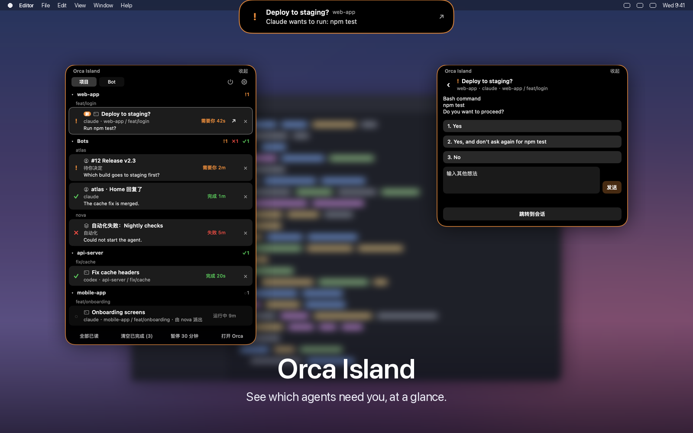

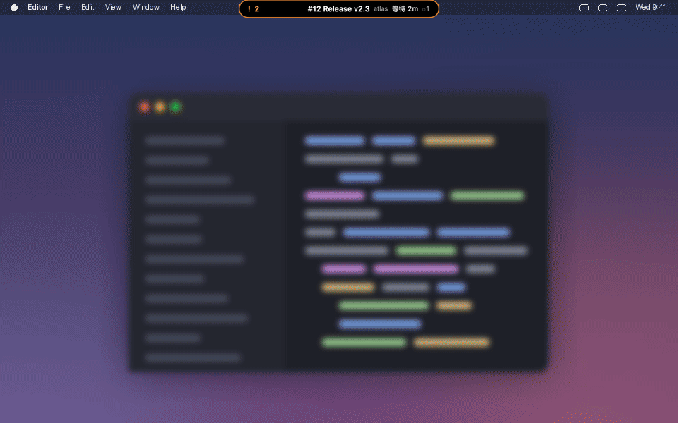

> The island's interface is in Chinese for now. The cover and these docs are language-neutral or bilingual. English UI is on the [roadmap](docs/roadmap.md).

## Features

### Needs you, at a glance

When Claude Code (or another agent) stops at a permission prompt, the island at the top of the screen turns amber and peeks the question.

Finished and failed turns show too, each with a short sound that you can turn off. Running agents only update the counts. Nothing opens by itself, and peeks close on their own.

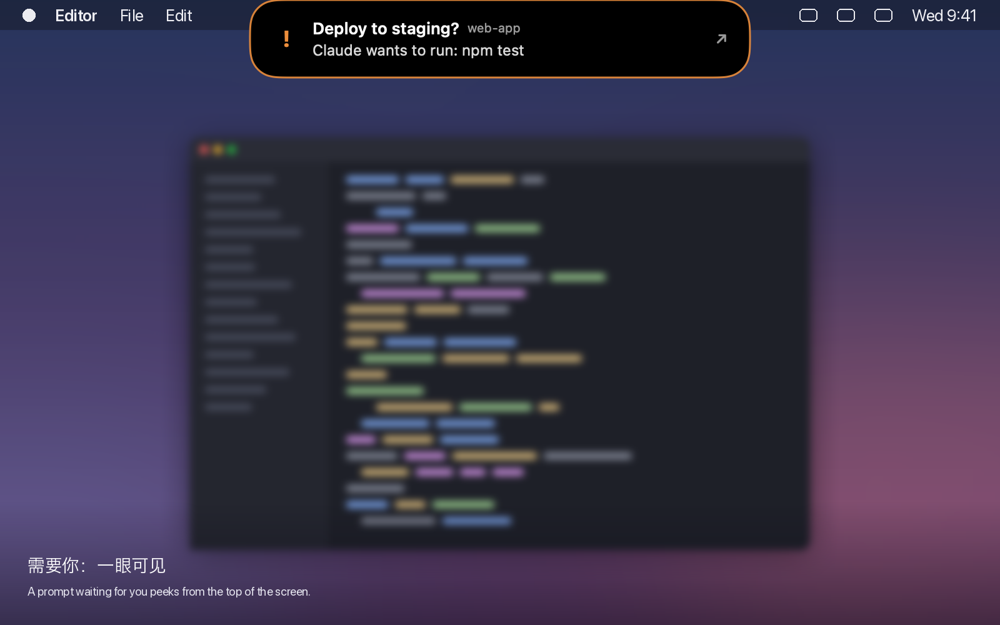

### Everything in one list

Click the island to open the list. It holds every agent, grouped by project or by bot:
- terminal sessions,
- Orca bot questions waiting for your decision,
- plugin approvals,
- failed automations,
- orchestration gates.

A small glyph shows what each row is: a terminal, a bot, or Orca itself. Hovering the island only makes it grow and glow; it does not open the list.

| By project | By bot |
|---|---|
| 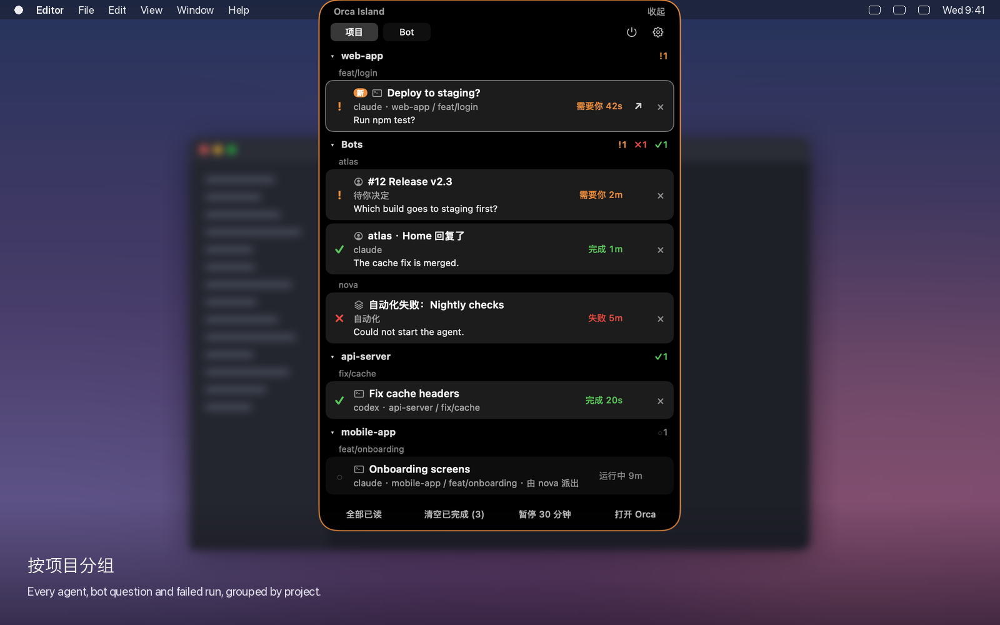 | 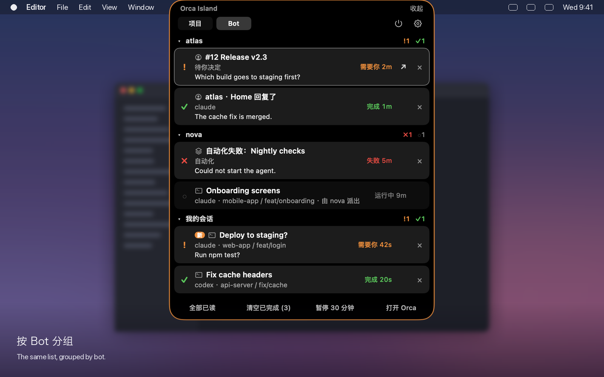 |

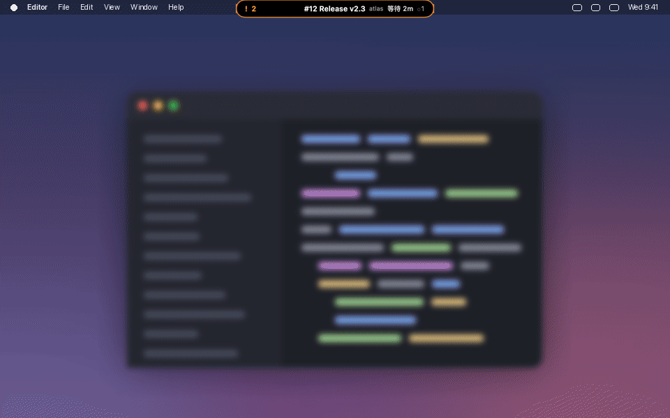

### Open a row, or jump straight there

- **Click a row** to open it in the island: you see the question, its options and where it comes from.
- **Jump to it in Orca:**
  - click **↗** on the row, the button in the opened row, or a peek;
  - or press **⌃⌥⇧U** anywhere for the next row that needs you.

  Terminal rows take you to that terminal. For bots, Orca can't yet open a specific tab, so the island says where to look, for example 「请在右侧切到『主页』」.

| A terminal prompt | A bot item with two questions | Where to look |
|---|---|---|
| 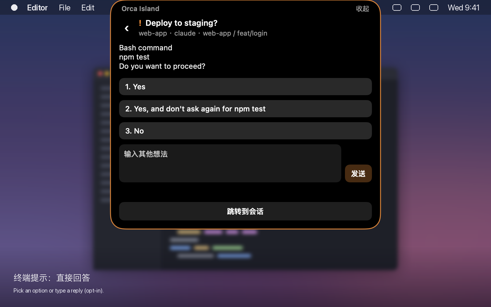 | 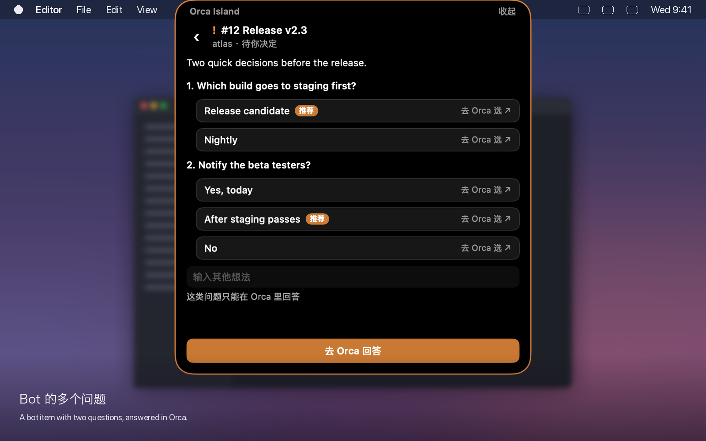 | 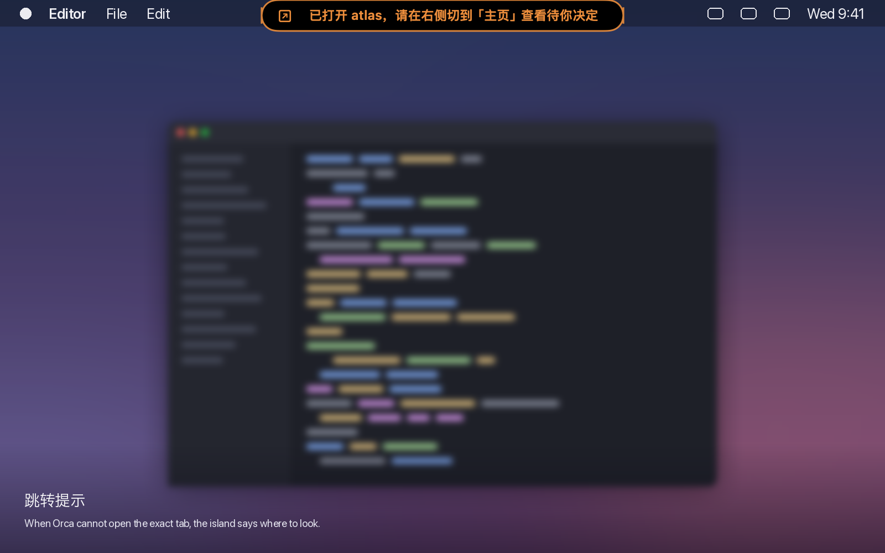 |

### Answer from the island (opt-in)

Answering is off by default. To use it, turn it on in ⚙ and confirm. You can then pick an option or type a reply to a Claude Code prompt without leaving what you are doing.

Before it types anything, the plugin checks that the prompt on screen is still the one you saw. Bot questions are answered in Orca.

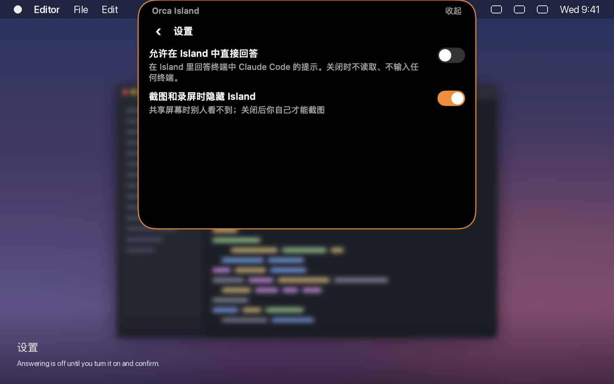

### Keep the list tidy

- **× on a finished row** removes it. It comes back only if that agent does something new.
- **× on a row that needs you** hides it for 30 minutes. It returns sooner if the question changes.
- **清空已完成 (N)** (clear finished) clears every finished row in one click.
- Each of these offers **撤销** (undo) for a few seconds.

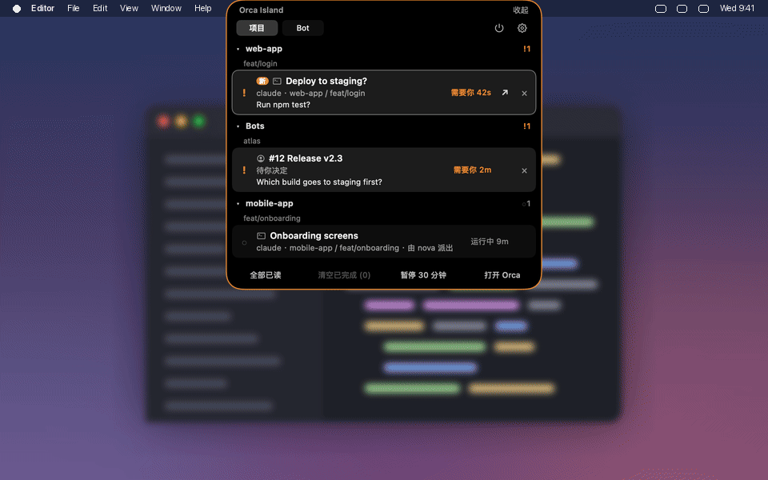

### Off switch

Turn the island off for an hour, until 8 tomorrow morning, or until you turn it back on. You can do this from:
- **⏻** in the list,
- the menu-bar icon,
- the **pause** button in Orca's status bar (off for 1 hour).

While it is off there is no island, sound, notification or hotkey, and terminals are neither read nor typed into. It keeps track in the background, though.

When it is off, Orca's status bar reads 「Island 已关闭」. Press that, or use the 「启用 Orca Island」 setting, to turn it back on. When it comes back you get one quiet summary of what changed meanwhile (for example 「关闭的 25 分钟里：2 个问题在等你回答…」).

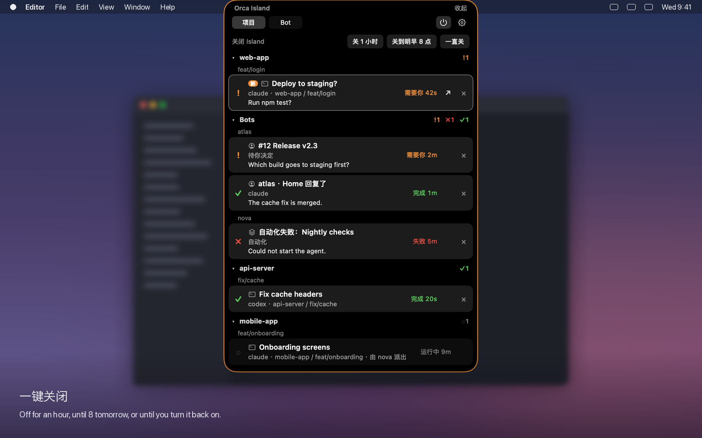

### Stays out of the way

- Silent while the screen is locked. When you come back, one short summary says what changed while you were away (「你离开的 1 小时 10 分钟里：…」), and clicking it opens the list at those rows.
- On a MacBook with a notch it grows out of the notch. On other screens it is a small pill at the top center. It can also live in the menu bar.
- Hidden from screenshots and screen recordings by default (best effort).

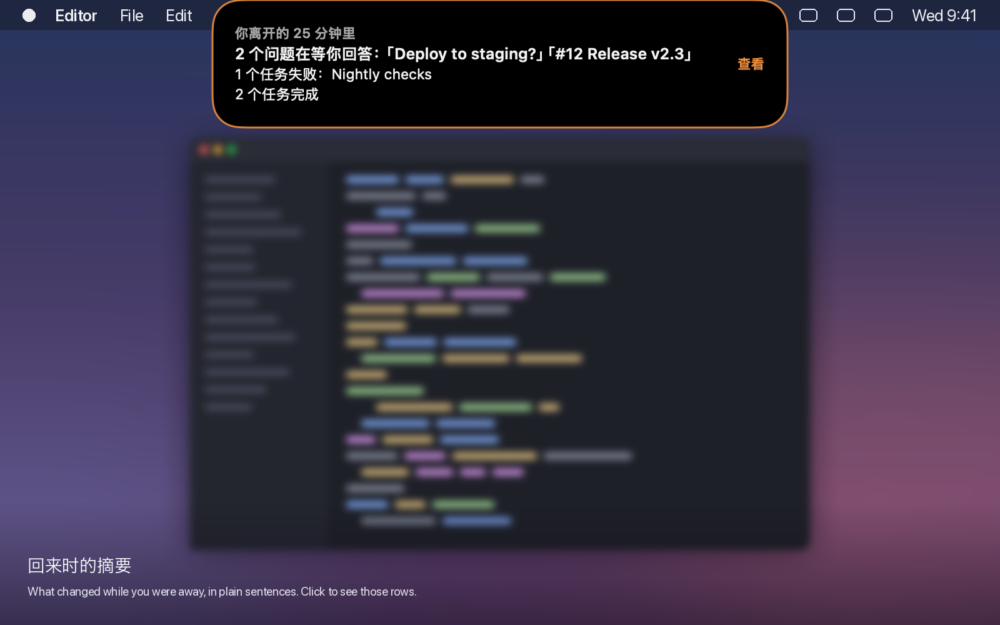

## Install

Requirements:
- macOS 14 or newer
- Orca 1.4.259 or newer
- the Xcode command-line tools (`xcode-select --install`). Without them a simpler island (the pill only) is used.

Install Orca Island from the Orca plugin directory, or from the command line:

```sh
orca plugin install Leo-Ni88/orca-island
```

Orca shows the access the plugin asks for (see [SECURITY.md](SECURITY.md)) and asks you to approve it.

On first start the plugin compiles its small Swift helper on your Mac. This takes about 10 seconds, and progress shows in Orca's status bar. The result is cached in `~/Library/Caches/orca-island/`. Nothing prebuilt is downloaded.

## Settings

In Orca's plugin settings, under Orca Island:

| Setting | Default | |
|---|---|---|
| 启用 Orca Island (enabled) | on | The off switch; also turns it back on |
| Island 程序 (helper) | Swift | Swift, JXA (pill only), or off (status bar and notifications only) |
| 提醒强度 (alert level) | 标准 | 安静: only needs-you and failures. 全部: also short turns |
| 显示位置 (where) | 自动 | Notch or pill, menu-bar icon only, or both |
| 声音 (sounds) | on | |
| 系统通知兜底 (fallback notifications) | on | System notifications when the island cannot be shown |
| 完成提醒的最短时长 (min. turn length) | 20 s | Shorter turns finish silently |
| 全局快捷键 ⌃⌥⇧U (hotkey) | on | Jump to the next row that needs you |
| 录屏和截图时隐藏 (hide from capture) | on | Best effort |
| 显示 Orca 的待你决定 (Orca decisions) | on | Bot questions, plugin approvals, failed automations, gates (via the `orca` CLI) |
| orca 命令行路径 (orcaCli) | empty | Path to the `orca` CLI; empty uses the one inside Orca.app |
| 记录事件 (record) | off | Stores raw agent and workspace events in plugin storage, for bug reports |
| 允许在 Island 中直接回答 (answering) | **off** | Also needs your confirmation in the island's ⚙ |

## Privacy

Everything stays on your Mac:
- no network requests and no analytics;
- no screen capture;
- terminal text is never stored or logged.

[SECURITY.md](SECURITY.md) lists exactly what the plugin reads and stores.

## Contributing

See [CONTRIBUTING.md](CONTRIBUTING.md), [docs/architecture.md](docs/architecture.md) and the [roadmap](docs/roadmap.md). Issues labelled [good first issue](https://github.com/Leo-Ni88/orca-island/labels/good%20first%20issue) are a good place to start.

## License

[MIT](LICENSE)

---

## 中文说明

Orca Island 是 [Orca](https://orca.dev) 的 macOS 插件。它在屏幕顶部显示一个刘海式的小岛：哪个 agent 在等你、哪个完成了、哪个失败了，一眼就能看到，并且能直接跳过去。

社区插件，不是 Orca 团队制作，也未经其认可。界面目前只有中文；封面图与语言无关。

### 功能

- **等你的事一眼可见**
  - Claude Code（或其他 agent）停在权限确认时，小岛变成琥珀色，并弹出问题预览。
  - 完成和失败也会提示，并播放简短的提示音（可关闭）。
  - 运行中的 agent 只更新计数。列表不会自己打开，预览会自动收起。
- **所有事情一个列表**
  - 点击小岛打开列表，可按项目或按 Bot 分组。
  - 列表包括：终端会话、等你决定的 Orca bot 问题、插件授权、失败的自动化，以及编排关卡。
  - 每行前有小图标，标明是终端、Bot 还是 Orca 自己的事项。
  - 悬停只会让小岛变大、发光，不会打开列表。
- **打开一行，或直接跳过去**
  - 点一行，在小岛里查看问题、选项和来源。
  - 要跳到 Orca：点这一行的 **↗**、打开后的按钮、或点预览；也可以在任何地方按 **⌃⌥⇧U** 跳到下一条等你的事。
  - 终端行会直接跳到那个终端。Bot 的具体标签页 Orca 还不能直接打开，小岛会告诉你去哪里找，例如「请在右侧切到『主页』」。
- **在小岛里直接回答（默认关闭）**
  - 在 ⚙ 里打开并确认后，可以直接选择选项或输入回复，回答 Claude Code 的提示。
  - 输入之前，插件会先确认终端上的提示仍是你看到的那一个。
  - Bot 的问题在 Orca 里回答。
- **保持列表整洁**
  - 已结束的行点 × 就移除，除非那个 agent 有新动作，否则不会再出现。
  - 「需要你」的行点 × 会隐藏 30 分钟；问题变了会立刻回来。
  - 「清空已完成 (N)」一次清掉所有已结束的行。
  - 以上操作都可以在几秒内「撤销」。
- **一键关闭**
  - 可以关 1 小时、关到明早 8 点，或一直关到你打开为止。
  - 入口有三个：列表里的 ⏻、菜单栏图标，以及 Orca 状态栏的暂停按钮（关 1 小时）。
  - 关闭期间：没有小岛、声音、通知和快捷键，也不读写任何终端；后台仍然记录状态。
  - 状态栏会显示「Island 已关闭」，点它或在设置里打开「启用 Orca Island」即可恢复。
  - 恢复时只显示一条安静的摘要，例如「关闭的 25 分钟里：2 个问题在等你回答…」，只算这段时间里新发生的事。
- **不打扰**
  - 锁屏时保持安静，回来后显示一条摘要，例如「你离开的 1 小时 10 分钟里：1 个任务失败…」；点它直接跳到这些新行。
  - 有刘海的 MacBook 上，小岛从刘海里展开；其他屏幕上，它是顶部居中的小药丸。也可以只显示在菜单栏。
  - 默认在截图和录屏中隐藏（尽力而为）。

### 安装

需要：
- macOS 14 或更新
- Orca 1.4.259 或更新
- Xcode 命令行工具（`xcode-select --install`）。没有时会使用只有药丸的简化版。

在 Orca 插件目录里安装，或在命令行运行：

```sh
orca plugin install Leo-Ni88/orca-island
```

Orca 会列出插件需要的权限（见 [SECURITY.md](SECURITY.md)），由你确认后才会启用。

首次启动时，插件会在你的 Mac 上编译它的 Swift 小程序，约 10 秒，进度显示在 Orca 状态栏。编译结果缓存在 `~/Library/Caches/orca-island/`，不会下载任何预编译程序。

### 设置

在 Orca 的插件设置里找到 Orca Island：

| 设置 | 默认 | 说明 |
|---|---|---|
| 启用 Orca Island | 开 | 总开关，也可以用来重新打开 |
| Island 程序 | Swift | Swift、JXA（只有药丸）或关闭（只用状态栏和通知） |
| 提醒强度 | 标准 | 安静：只提醒需要你和失败；全部：短任务也提醒 |
| 显示位置 | 自动 | 刘海或药丸、仅菜单栏图标，或两者都有 |
| 声音 | 开 | |
| 系统通知兜底 | 开 | 小岛无法显示时改用系统通知 |
| 完成提醒的最短时长（秒） | 20 | 更短的任务完成时不提醒 |
| 全局快捷键 ⌃⌥⇧U | 开 | 跳到下一条需要你处理的事 |
| 录屏和截图时隐藏 | 开 | 尽力而为 |
| 显示 Orca 的待你决定 | 开 | 通过 `orca` 命令行读取 bot 问题、插件授权、失败的自动化、编排关卡 |
| orca 命令行路径 | 空 | 留空时使用 Orca.app 自带的 |
| 记录事件 | 关 | 把原始的 agent 和工作区事件存入插件存储，用于报告问题 |
| 允许在 Island 中直接回答 | **关** | 开启时还需要在小岛的 ⚙ 里确认 |

### 隐私

所有数据都留在你的 Mac 上：
- 不联网，不做任何统计；
- 不截屏；
- 不存储、不记录终端内容。

插件读取和存储的内容详见 [SECURITY.md](SECURITY.md)。

### 参与开发

见 [CONTRIBUTING.md](CONTRIBUTING.md)、[docs/architecture.md](docs/architecture.md) 和 [路线图](docs/roadmap.md)。可以从标记为 [good first issue](https://github.com/Leo-Ni88/orca-island/labels/good%20first%20issue) 的 issue 开始。

### 许可证

[MIT](LICENSE)
